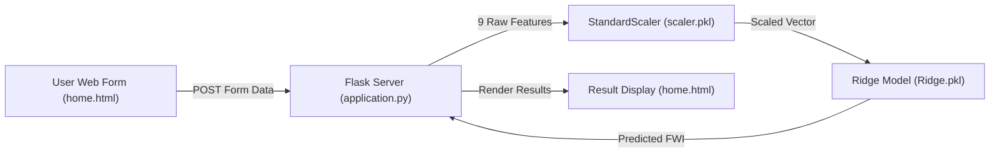

# 🔥 Test Forest Fires: Prediction & Classification Analysis

[](LICENSE)
[](https://www.python.org/)
[](https://flask.palletsprojects.com/)
[](https://scikit-learn.org/)
[](https://pandas.pydata.org/)
[](https://github.com/MandyCodeX/algerian-forest-fire-classification/pulls)

An end-to-end Machine Learning and Web Application project analyzing meteorological data to predict the **Fire Weather Index (FWI)** and classify wildfire risks across two regions in Algeria (**Bejaia** and **Sidi-Bel Abbes**). 

The repository provides full data science lifecycle artifacts: extensive Exploratory Data Analysis (EDA), feature engineering with multicollinearity elimination, regularized linear regression modeling (Linear, Lasso, Ridge, ElasticNet with 5-Fold Cross-Validation), model serialization, and an interactive **Flask web application** for real-time inference.

---

## 📌 Table of Contents

- [Project Overview](#-project-overview)
- [Repository Structure](#-repository-structure)
- [Dataset Summary & Statistics](#-dataset-summary--statistics)
- [FWI System Components](#-fwi-system-components)
- [Exploratory Data Analysis (EDA) Insights](#-exploratory-data-analysis-eda-insights)
- [Feature Engineering & Multicollinearity Removal](#-feature-engineering--multicollinearity-removal)
- [Model Training & Real Evaluation Results](#-model-training--real-evaluation-results)
- [Deployed Model Specification](#-deployed-model-specification)
- [Flask Web Application](#-flask-web-application)
- [Real Inference Demonstrations](#-real-inference-demonstrations)
- [Installation & Local Setup](#-installation--local-setup)
- [Technologies Used](#-technologies-used)
- [License](#-license)
- [Author](#-author)

---

## 📖 Project Overview

Wildfires in Mediterranean forest ecosystems inflict immense ecological devastation and economic losses. Predicting wildfire severity and spread potential enables forestry authorities and emergency responders to proactively deploy firefighting resources.

This project utilizes real-world meteorological observations and indices from the **Canadian Forest Fire Weather Index (FWI) System** collected in two Algerian regions:
1. **Bejaia Region**: Located in Northeast Algeria, characterized by coastal and humid mountainous terrain.
2. **Sidi-Bel Abbes Region**: Located in Northwest Algeria, characterized by semi-arid inland conditions.

### Core Objectives:
- **Risk Classification Analysis:** Distinguishing patterns and environmental thresholds separating fire outbreaks (`fire`) from non-fire periods (`not fire`).
- **Regression Modeling:** Accurately predicting the continuous **Fire Weather Index (FWI)** rating using regularized linear regression techniques with cross-validation.
- **Production Web Deployment:** Serving the trained pipeline (StandardScaler + Ridge Regressor) via an interactive Flask web UI.

---

## 📁 Repository Structure

```text
algerian-forest-fire-classification/
├── application.py                                   # Flask web server & inference routes
├── requirement.txt                                  # Production Python dependencies
├── models/
│   ├── Ridge.pkl                                    # Serialized trained Ridge regression model
│   └── scaler.pkl                                   # Serialized StandardScaler pipeline
├── notebook/
│   ├── Algerian_forest_fires_cleaned_dataset.csv    # Cleaned dataset (243 rows, 15 columns)
│   ├── Algerian_forest_fires_dataset_UPDATE.csv     # Raw dataset from UCI repository
│   ├── EDA_and_FE.ipynb                             # Exploratory Data Analysis & Feature Engineering
│   └── Model_Training.ipynb                         # Model training, cross-validation & evaluation
├── templates/
│   ├── index.html                                   # Web application landing page
│   └── home.html                                    # Prediction form & real-time result view
├── .gitignore                                       # Git ignore rules for Python & environments
├── LICENSE                                          # MIT License
└── README.md                                        # Project documentation
```

---

## 📊 Dataset Summary & Statistics

The dataset spans daily observations from **June 1, 2012 to September 30, 2012**.

| Metric | Raw Value | Cleaned Value | Notes |
| :--- | :--- | :--- | :--- |
| **Total Rows** | 246 | **243** | Cleaned rows remove region separation headers & null instances |
| **Bejaia Observations (Region 0)** | 122 | **122** | Coastal / humid mountain zone |
| **Sidi-Bel Abbes (Region 1)** | 124 | **121** | Semi-arid inland zone |
| **Target Variable (Regression)** | `FWI` | `FWI` | Continuous numeric rating of fire danger |
| **Target Variable (Classification)** | `Classes` | `Classes` | **Fire: 137 (56.38%)** \| **Not Fire: 106 (43.62%)** |

### Real Summary Statistics (243 Cleaned Records)

| Attribute | Meaning | Unit | Min | 25% | Median | 75% | Max | Mean | Std Dev |
| :--- | :--- | :---: | :---: | :---: | :---: | :---: | :---: | :---: | :---: |
| **Temperature** | Noon Temperature | °C | 22.0 | 30.0 | 32.0 | 35.0 | 42.0 | **32.15** | 3.63 |
| **RH** | Relative Humidity | % | 21.0 | 52.5 | 63.0 | 73.5 | 90.0 | **62.04** | 14.83 |
| **Ws** | Wind Speed | km/h | 6.0 | 14.0 | 15.0 | 17.0 | 29.0 | **15.49** | 2.81 |
| **Rain** | Daily Rainfall | mm | 0.0 | 0.0 | 0.0 | 0.5 | 16.8 | **0.76** | 2.00 |
| **FFMC** | Fine Fuel Moisture Code | index | 28.6 | 71.8 | 83.3 | 88.3 | 96.0 | **77.84** | 14.35 |
| **DMC** | Duff Moisture Code | index | 0.7 | 5.8 | 11.3 | 20.8 | 65.9 | **14.68** | 12.39 |
| **DC** | Drought Code | index | 6.9 | 12.3 | 33.1 | 69.1 | 220.4 | **49.43** | 47.67 |
| **ISI** | Initial Spread Index | index | 0.0 | 1.4 | 3.5 | 7.25 | 19.0 | **4.74** | 4.15 |
| **BUI** | Buildup Index | index | 1.1 | 6.0 | 12.4 | 22.65 | 68.0 | **16.69** | 14.23 |
| **FWI** | Fire Weather Index | index | 0.0 | 0.7 | 4.2 | 11.45 | 31.1 | **7.04** | 7.44 |

---

## 🌲 FWI System Components

The Canadian Forest Fire Weather Index (FWI) System consists of six standard components:

1. **FFMC (Fine Fuel Moisture Code):** Numerical rating of the moisture content of litter and cured fine fuels (fast response to rain/humidity).
2. **DMC (Duff Moisture Code):** Rating of average moisture content of loosely compacted organic layers of moderate depth.
3. **DC (Drought Code):** Rating of moisture content of deep, compact organic layers (seasonal drought indicator).
4. **ISI (Initial Spread Index):** Expected rate of fire spread combining wind speed and FFMC without fuel quantity.
5. **BUI (Buildup Index):** Total amount of fuel available for combustion, combining DMC and DC.
6. **FWI (Fire Weather Index):** General index of fire intensity combining ISI and BUI (the primary regression prediction target).

---

## 🔍 Exploratory Data Analysis (EDA) Insights

From [`notebook/EDA_and_FE.ipynb`](notebook/EDA_and_FE.ipynb), several real-world environmental patterns were established:

1. **Seasonal Fire Distribution:**
   - **June:** Fire activity initiates as temperatures rise.
   - **July & August:** Peak fire season across both Bejaia and Sidi-Bel Abbes. Sustained temperatures $> 32^\circ\text{C}$ and low relative humidity ($< 50\%$) drove peak FWI values.
   - **September:** Sudden decrease in fire incidence due to cooler temperatures and rainfall events.
2. **Critical Risk Thresholds:**
   - Fires rarely occurred when **Rain $> 1.0\text{ mm}$**.
   - Outbreaks clustered when **Temperature $> 30^\circ\text{C}$** and **Relative Humidity $< 60\%$**.
   - High **FFMC ($> 80$)** and **ISI ($> 5$)** correlated strongly with explosive fire growth.
3. **Regional Variances:**
   - Sidi-Bel Abbes recorded higher maximum temperatures (up to $42^\circ\text{C}$) and lower average humidity compared to coastal Bejaia, resulting in a higher concentration of severe fire days.

---

## ⚙️ Feature Engineering & Multicollinearity Removal

### 1. Data Cleaning
- Column name whitespaces stripped (e.g., `' RH'` $\rightarrow$ `'RH'`).
- Header artifact at row index 122 removed.
- String datatypes safely cast to integer (`day`, `month`, `year`, `Temperature`, `RH`, `Ws`, `Region`) and float (`Rain`, `FFMC`, `DMC`, `DC`, `ISI`, `BUI`, `FWI`).
- Binary encoding applied to `Classes`:
  $$\text{Classes} = \begin{cases} 1 & \text{if 'fire'} \\ 0 & \text{if 'not fire'} \end{cases}$$

### 2. Multicollinearity Detection & Resolution
Correlations between independent variables were computed on the training set:
- $\text{corr}(\text{DMC}, \text{DC}) = 0.869$ ($> 0.85$)
- $\text{corr}(\text{DMC}, \text{BUI}) = 0.983$ ($> 0.85$)
- $\text{corr}(\text{DC}, \text{BUI}) = 0.942$ ($> 0.85$)

To prevent severe variance inflation and coefficient instability, features with correlation $> 0.85$ were systematically pruned:
- **Dropped Features:** **`DC`** and **`BUI`** (redundant given `DMC`).
- **Date Features Dropped:** `day`, `month`, and `year` removed to avoid calendar overfitting.
- **Retained Features (9 total):**
  `['Temperature', 'RH', 'Ws', 'Rain', 'FFMC', 'DMC', 'ISI', 'Classes', 'Region']`

### 3. Data Splitting & Normalization
- **Split Ratio:** 75% Training ($n = 182$) and 25% Testing ($n = 61$) with `random_state = 42`.
- **Scaling:** Features normalized via `StandardScaler` fitted strictly on `X_train`.

---

## 🏆 Model Training & Real Evaluation Results

All models were evaluated on the held-out 61-sample test set using **Mean Absolute Error (MAE)** and the **$R^2$ Score** in [`notebook/Model_Training.ipynb`](notebook/Model_Training.ipynb):

### Real Evaluation Benchmark

| Model | Hyperparameters / CV Strategy | Test MAE | Test $R^2$ Score | Key Observations |
| :--- | :--- | :---: | :---: | :--- |
| **Linear Regression** | Ordinary Least Squares (OLS) | **0.5468** | **0.9848** (98.48%) | Strongest baseline explanatory power |
| **Ridge Regression** | L2 Penalty ($\alpha = 1.0$) | **0.5642** | **0.9843** (98.43%) | **Selected for production**; robust against weight explosion |
| **RidgeCV** | 5-Fold Cross-Validation ($\alpha = 1.0$) | **0.5642** | **0.9843** (98.43%) | Identical optimal $\alpha$, verifying cross-validation stability |
| **Lasso Regression** | L1 Penalty ($\alpha = 1.0$) | 1.1332 | 0.9492 (94.92%) | High default penalty over-dampens coefficients |
| **LassoCV** | 5-Fold Cross-Validation ($\alpha \approx 0.0658$) | 0.6359 | 0.9814 (98.14%) | Cross-validation tunes sparsity and restores accuracy |
| **ElasticNet** | L1 + L2 Penalty ($\alpha = 1.0$, l1_ratio = 0.5) | 1.8822 | 0.8753 (87.53%) | Default parameter dampens feature influence heavily |
| **ElasticNetCV** | 5-Fold Cross-Validation ($\alpha \approx 0.0431$) | 0.6576 | 0.9814 (98.14%) | Fine-tuned $\alpha$ substantially recovers performance |

> **Conclusion:** **Ridge Regression** delivers exceptional generalization ($R^2 = 98.43\%$, $\text{MAE} = 0.5642$) with stable, bounded weights, making it optimal for live production inference.

---

## 📐 Deployed Model Specification

The deployed pipeline consists of the fitted `StandardScaler` and `Ridge` model saved in `models/`:

### Mathematical Formula:
$$\widehat{\text{FWI}} = \beta_0 + \sum_{j=1}^{9} \beta_j \left( \frac{x_j - \mu_j}{\sigma_j} \right)$$

Where **$\beta_0 = 7.1560$** (Intercept) and the feature parameters are:

| Feature Index ($j$) | Feature Name | Mean ($\mu_j$) | Scale ($\sigma_j$) | Ridge Weight ($\beta_j$) |
| :---: | :--- | :---: | :---: | :---: |
| 1 | `Temperature` | 32.1154 | 3.6963 | -0.0269 |
| 2 | `RH` | 62.2747 | 14.9733 | -0.2052 |
| 3 | `Ws` | 15.5769 | 2.6337 | +0.0255 |
| 4 | `Rain` | 0.8209 | 2.1374 | -0.0407 |
| 5 | `FFMC` | 77.6335 | 14.3181 | -0.7858 |
| 6 | `DMC` | 14.7363 | 12.6157 | **+3.6829** |
| 7 | `ISI` | 4.8198 | 4.3196 | **+4.7449** |
| 8 | `Classes` | 0.5495 | 0.4975 | +0.4342 |
| 9 | `Region` | 0.4945 | 0.5000 | -0.3847 |

> **Key Weight Insight:** `ISI` (+4.74) and `DMC` (+3.68) carry the highest positive weight in the prediction of FWI, accurately reflecting fire propagation dynamics.

---

## 🌐 Flask Web Application

The repository includes a ready-to-run Flask web server in `application.py`:

- **`GET /`**: Renders `templates/index.html` (Landing page).
- **`GET /predictdata`**: Renders `templates/home.html` (Interactive prediction form).
- **`POST /predictdata`**: Receives form values, scales them through `scaler.pkl`, executes inference via `Ridge.pkl`, and displays the exact predicted FWI rating.



---

## 🧪 Real Inference Demonstrations

Here are real sample predictions produced by the deployed pipeline across various environmental conditions:

### Case 1: Low Fire Risk (Bejaia Region, Early Summer)
- **Input Parameters:**
  `Temperature = 29.0`, `RH = 57.0`, `Ws = 18.0`, `Rain = 0.0`, `FFMC = 65.7`, `DMC = 3.4`, `ISI = 1.3`, `Classes = 0 (Not Fire)`, `Region = 0 (Bejaia)`
- **Actual FWI in Dataset:** `0.5`
- **Model Output:** **`0.67`** *(Low Risk)*

### Case 2: Elevated Wildfire Risk (Sidi-Bel Abbes Region, Mid Summer)
- **Input Parameters:**
  `Temperature = 35.0`, `RH = 43.0`, `Ws = 16.0`, `Rain = 0.0`, `FFMC = 88.7`, `DMC = 24.3`, `ISI = 7.4`, `Classes = 1 (Fire)`, `Region = 1 (Sidi-Bel Abbes)`
- **Actual FWI in Dataset:** `12.5`
- **Model Output:** **`12.44`** *(High Danger)*

### Case 3: Extreme Wildfire Hazard (High Wind & Drought Conditions)
- **Input Parameters:**
  `Temperature = 39.0`, `RH = 35.0`, `Ws = 14.0`, `Rain = 0.0`, `FFMC = 91.3`, `DMC = 49.5`, `ISI = 14.0`, `Classes = 1 (Fire)`, `Region = 1 (Sidi-Bel Abbes)`
- **Actual FWI in Dataset:** `27.0`
- **Model Output:** **`26.97`** *(Extreme Hazard)*

---

## 🚀 Installation & Local Setup

### 1. Clone the Repository
```bash
git clone https://github.com/MandyCodeX/testforestfire.git
cd testforestfire
```

### 2. Create and Activate a Virtual Environment
```bash
python3 -m venv venv
source venv/bin/activate        # On macOS/Linux
# venv\Scripts\activate         # On Windows
```

### 3. Install Required Packages
```bash
pip install -r requirement.txt
```

### 4. Run the Flask Web Application
```bash
python application.py
```
Open your browser and navigate to:
```text
http://127.0.0.1:5002/predictdata
```

### 5. (Optional) Run Jupyter Notebooks
To explore data analysis and model training workflows:
```bash
pip install jupyter matplotlib seaborn
jupyter notebook
```
Navigate to `notebook/EDA_and_FE.ipynb` or `notebook/Model_Training.ipynb`.

### 6. Testing Inference via cURL
You can query the prediction endpoint directly:
```bash
curl -X POST http://127.0.0.1:5002/predictdata \
  -d "Temperature=35" \
  -d "RH=43" \
  -d "Ws=16" \
  -d "Rain=0.0" \
  -d "FFMC=88.7" \
  -d "DMC=24.3" \
  -d "ISI=7.4" \
  -d "Classes=1" \
  -d "Region=1"
```

---

## 🛠️ Technologies Used

- **Programming Language:** Python 3.8+
- **Web Framework:** Flask 3
- **Machine Learning Library:** Scikit-Learn (LinearRegression, Ridge, Lasso, ElasticNet, StandardScaler, RidgeCV, LassoCV, ElasticNetCV)
- **Data Manipulation:** NumPy, Pandas
- **Visualization:** Matplotlib, Seaborn
- **Environment & Tools:** Jupyter Notebook, Git, GitHub

---

## 📄 License

This project is licensed under the MIT License - see the [LICENSE](LICENSE) file for details.

---

## 👤 Author

**Mandeep Kumar**
- GitHub: [@MandyCodeX](https://github.com/MandyCodeX)
- Email: immandy108@gmail.com
- Repository: [algerian-forest-fire-classification](https://github.com/MandyCodeX/algerian-forest-fire-classification)
